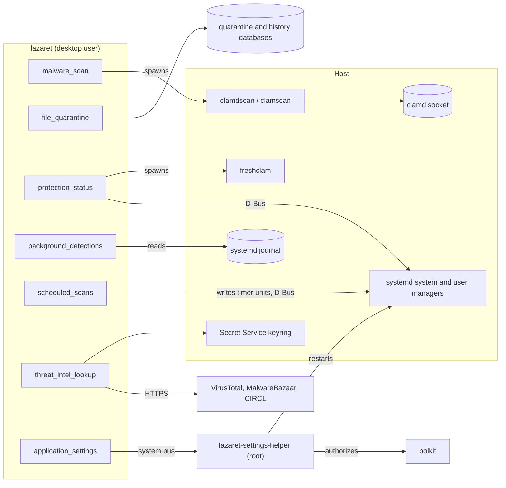
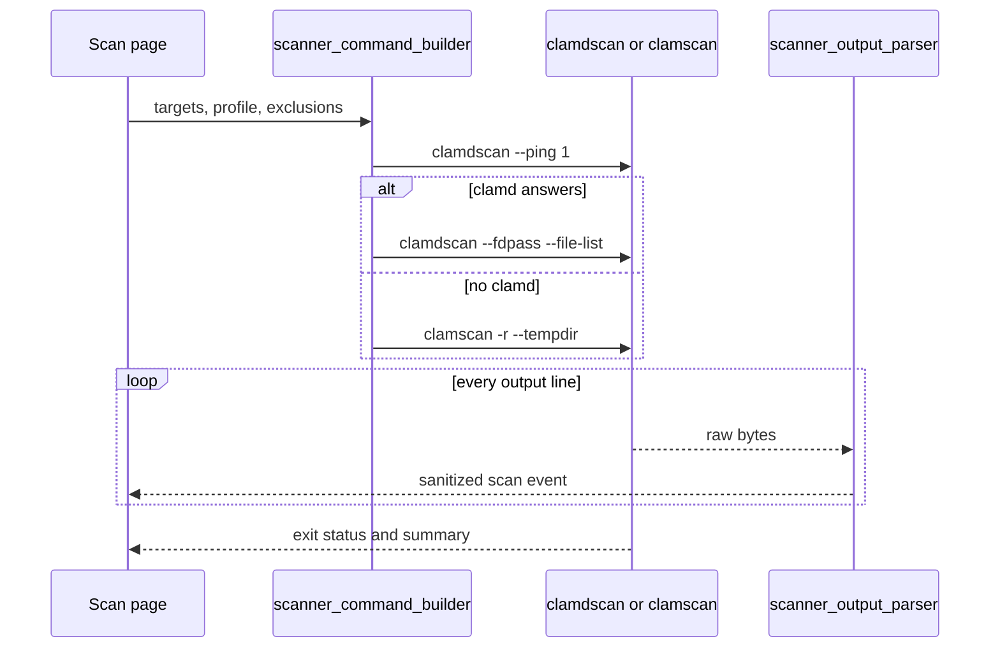
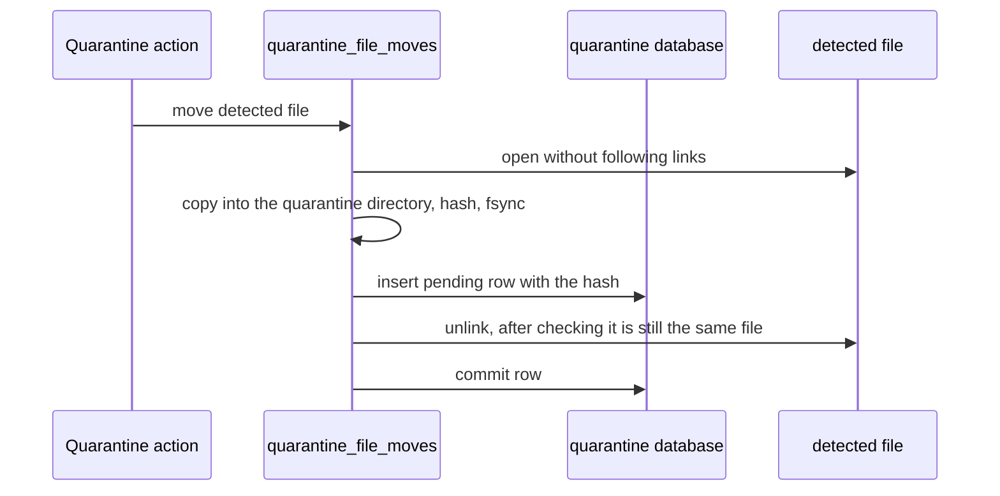
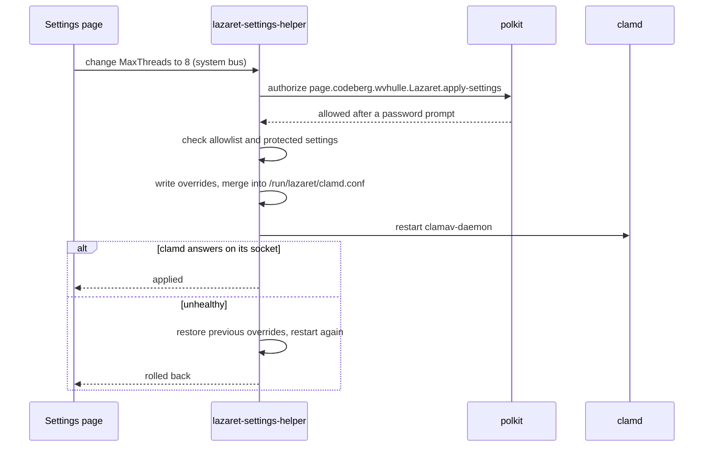
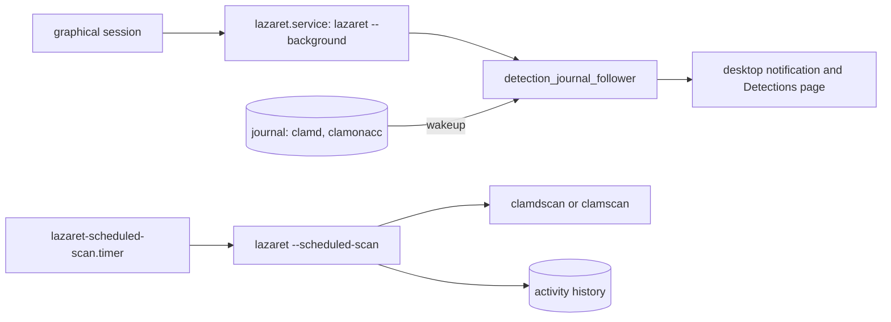
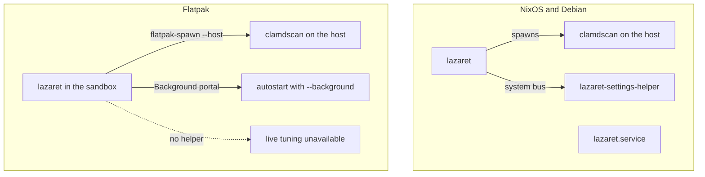

# Architecture

Lazaret is a desktop front-end for the ClamAV that is already installed on the host. It never bundles a scan engine and never runs as root. This page describes how the pieces fit together and which rules keep them safe. The rules for changing the code are in [development](development.md).

## Components

The source is organised by feature: each directory under `src/` holds the logic of one feature next to its page. `settings_helper/` is the only code that runs with privileges, and `xtask/` holds the repository tasks: screenshots, packaging and releases.

Lazaret talks to the host in three ways, and never through shell commands like `systemctl` or `journalctl`:

- It spawns the ClamAV programs found on `PATH`: `clamdscan --fdpass`, `clamscan` and `freshclam`.
- It talks to systemd over D-Bus (`src/systemd_bus/`), for unit states, starting units and installing timers.
- It reads the journal through libsystemd (`src/systemd_journal/`).

Pages react to D-Bus signals and journal wakeups. They don't refresh on timers.

## Scanning

When clamd answers a ping, Lazaret scans through it and passes file descriptors with `--fdpass`, so clamd can read files the desktop user can read. Otherwise it falls back to `clamscan`. The scanner's output is a stream (`impl Stream`) of byte lines. File names can be arbitrary bytes, so lines are split as bytes and decoded lossily. Scanner text is sanitized before it is shown, and rows that show file names never interpret markup.

## Quarantine

A move always runs in this order: copy, pending row, remove source, commit. Every open is no-follow, and the payload is checked against the hash before the source is removed. A crash at any step leaves either the original file or a complete, recorded copy. A pending row tells the next start which step to finish. A move that has started is never aborted.

## Live tuning

The helper is started by D-Bus activation. It authorizes each request with polkit, so the GUI is never trusted. It only accepts settings listed in `/etc/lazaret/tunable-settings`. It always refuses settings from `data/protected-clamav-settings.txt`, the settings that run commands or change identity, even when they are on the allowlist. Changes are stored in `/var/lib/lazaret/clamd-overrides.conf` and merged with `/etc/clamav/clamd.conf` into `/run/lazaret/clamd.conf`, which clamd is configured to read. Without any overrides, the merged file equals the base file.

## Background alerts and scheduled scans

`lazaret --background` runs without a window and follows the journal of the ClamAV services. A detection by clamd or clamonacc raises an alert, and the Detections page shows its timeline. Scheduled scans are a systemd user timer and service that Lazaret writes to `~/.config/systemd/user`. The service runs a headless scan with the same scanner code as the Scan page.

## Deployments

The NixOS module and the Debian package install the helper, its polkit action, its D-Bus configuration and the user service. The Flatpak can't ship a privileged helper, so live tuning is not available there. Inside the sandbox, Lazaret runs the ClamAV programs on the host with `flatpak-spawn --host`. Paths under `/run/host` are translated back to host paths before they reach the scanner. The sandbox starts in the background through the Background portal instead of a systemd user service.
