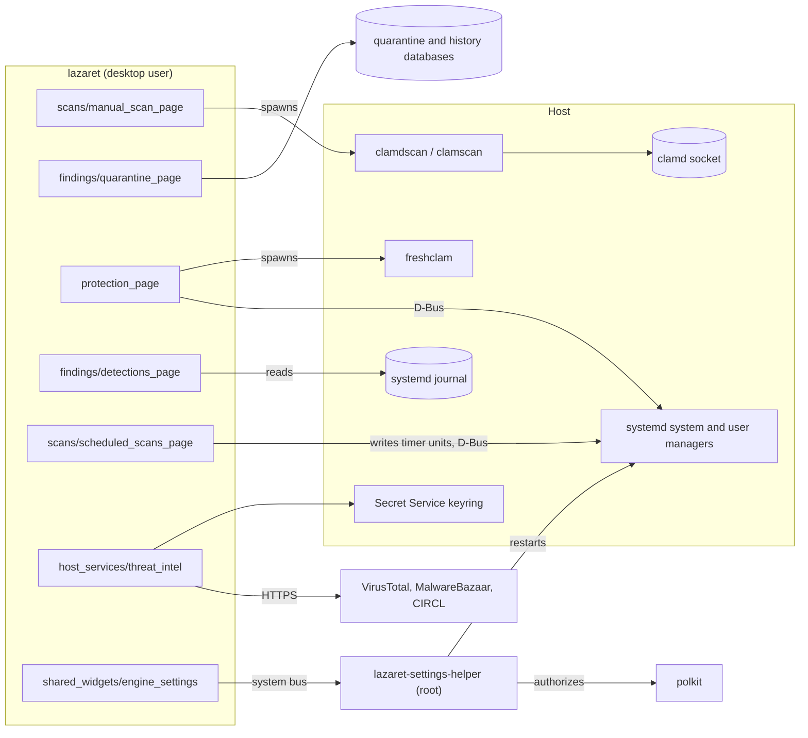
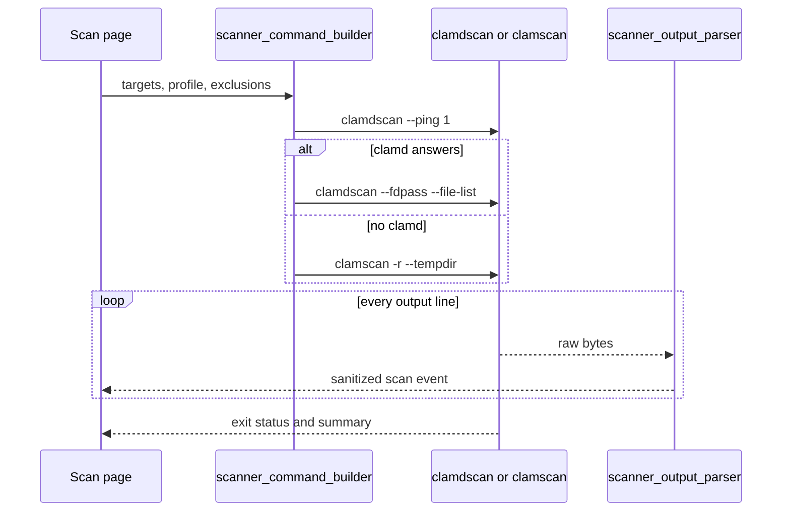
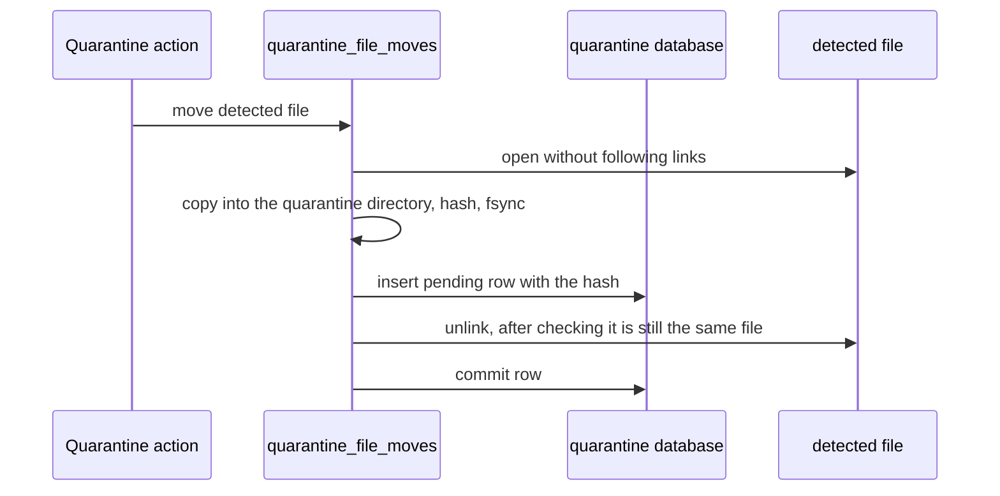
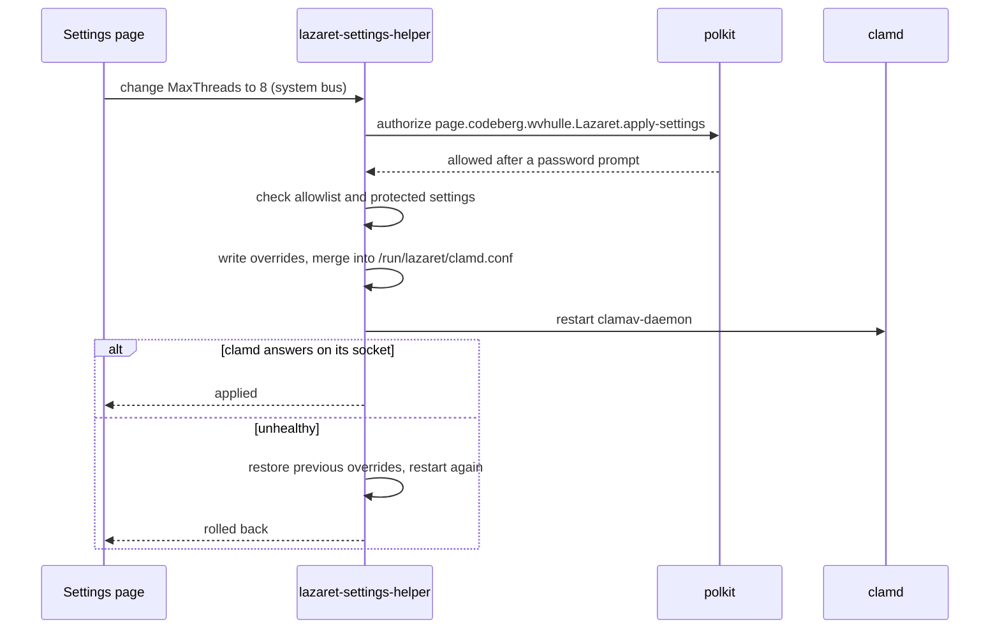
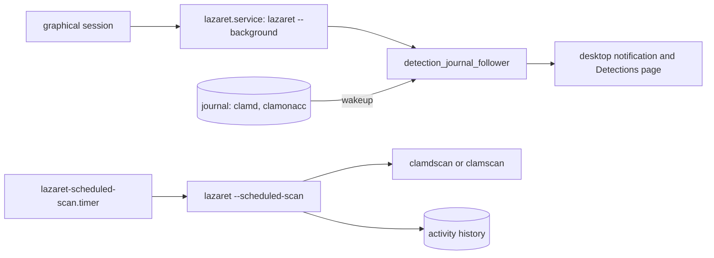
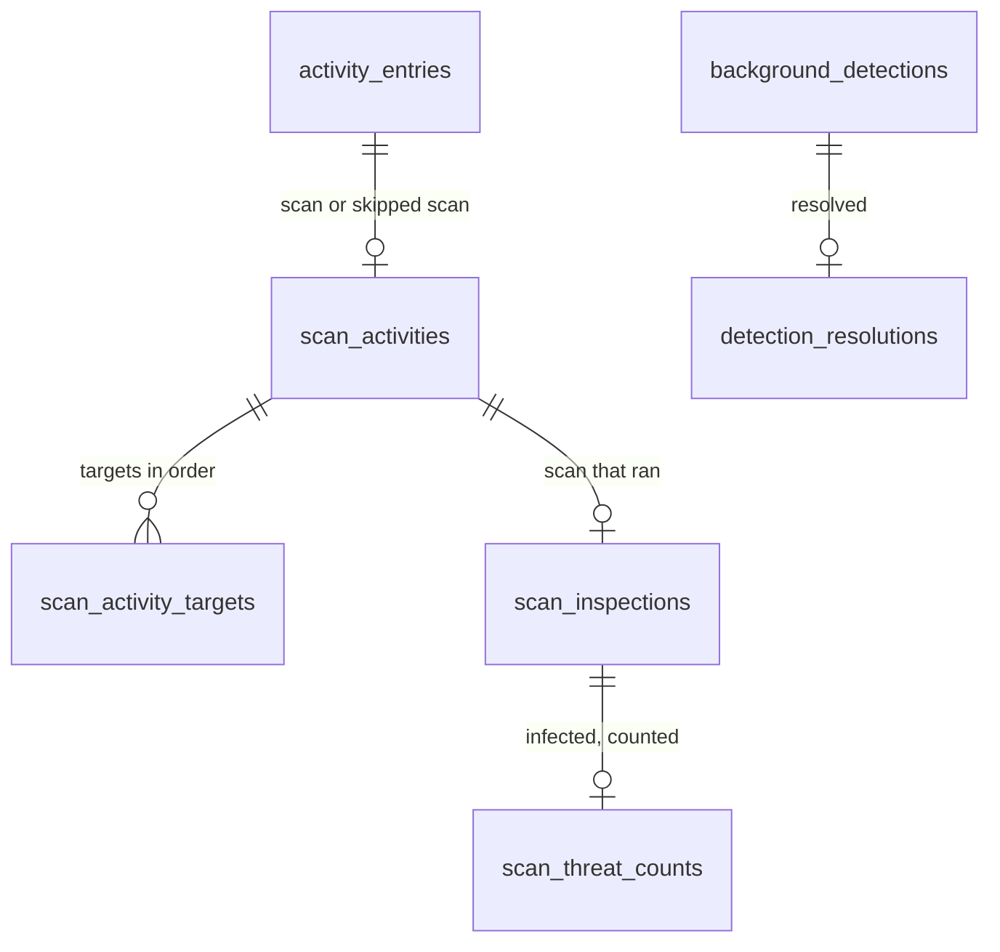
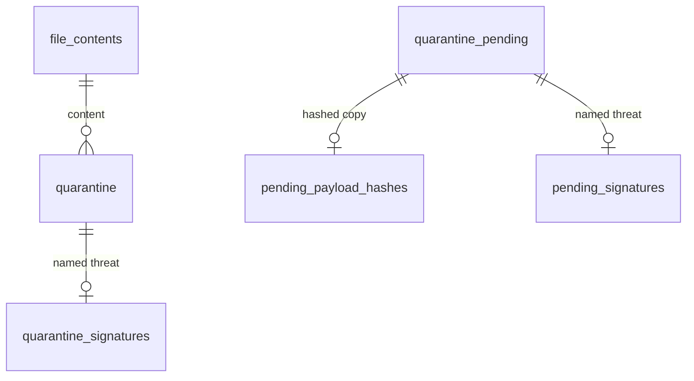
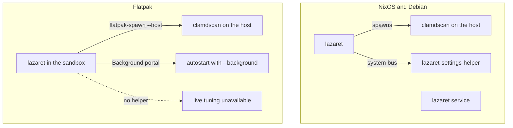

# Architecture

Lazaret is a desktop front-end for the ClamAV that is already installed on the host. It never bundles a scan engine and never runs as root. This page describes how the pieces fit together and which rules keep them safe. The rules for changing the code are in [development](development.md).

## Components

The source follows the window as you see it. Sidebar groups have a directory under `src/` with one directory per page: `signatures/` (`signature_sources_page/`, `database_updates_page/`), `scans/` (`manual_scan_page/`, `scheduled_scans_page/`), `findings/` (`detections_page/`, `quarantine_page/`) and `sharing/` (`analysis_page/`). The remaining pages have their own directory: `protection_page/`, `logs_page/` and `hardening_page/`. The subpages and dialogs you open from a page sit in directories inside it, for example `scans/manual_scan_page/exclusions_page/`. `application_window/` holds the window, sidebar, tray and actions, and `preferences_dialog/` holds the Preferences dialog. Widgets that several pages share live in `shared_widgets/`. Code you never see on screen lives in `host_services/`, grouped by what it talks to: the ClamAV programs, the quarantine vault, systemd, the journal, the settings helper and online lookups, with the protection evidence the status timeline reads in `host_services/protection_evidence/`. `headless_modes/` holds the scheduled scan that runs without a window. `settings_helper/` is the only code that runs with privileges, and `xtask/` holds the repository tasks: screenshots and recordings, packaging and releases.

The interface follows the Elm architecture through Relm4. The window shell owns startup, the tray and the close behaviour. A page navigation component owns the sidebar, the page stack and the settings subpages. Every page and dialog keeps its state in a plain model that only `update` changes, in answer to messages from widgets, child components, GTK actions and finished commands. Settings stored in GSettings are mirrored into the models that show them: a change sends a message, and `update` writes it back. Work that waits on the host runs as a command, and its outcome returns as a message, so no state is shared between widgets.

Lazaret talks to the host in three ways, and never through shell commands like `systemctl` or `journalctl`:

- It spawns the ClamAV programs found on `PATH`: `clamdscan --fdpass`, `clamscan` and `freshclam`. It only runs a copy that the desktop user can't replace: the file, every directory above it and every symbolic link on the way must be out of the user's control. Copies the user could replace, such as one in `~/.local/bin`, are skipped and reported on the Protection page. That way malware running as the user can't plant a fake `clamdscan` that reports every file as clean.
- It talks to systemd over D-Bus (`src/host_services/systemd_bus/`), for unit states, starting units and installing timers.
- It reads the journal through libsystemd (`src/host_services/systemd_journal/`).

Pages react to D-Bus signals and journal wakeups. They don't refresh on timers.

## Scanning

When clamd answers a ping, Lazaret scans through it and passes file descriptors with `--fdpass`, so clamd can read files the desktop user can read. Otherwise it falls back to `clamscan`. The scanner's output is a stream (`impl Stream`) of byte lines. File names can be arbitrary bytes, so lines are split as bytes and decoded lossily. Scanner text is sanitized before it is shown, and rows that show file names never interpret markup.

## Quarantine

A move always runs in this order: copy, pending row, remove source, commit. Every open is no-follow, and the payload is checked against the hash before the source is removed. A crash at any step leaves either the original file or a complete, recorded copy. A pending row tells the next start which step to finish. A move that has started is never aborted.

Payloads are stored neutralized: a header with a random per-file key, followed by the content XORed with that key. Other scanners, indexers and thumbnailers then see nothing they recognize, and a payload can't be run by accident. The recorded SHA-256 is always that of the original content, and every read decodes the payload first. A payload stored raw, such as one renamed into quarantine because on-access scanning blocked reading it, is neutralized afterwards by writing an encoded copy next to it, checking its hash and renaming it over the raw file. A crash leaves either the raw or the encoded payload, and both read back the same.

Quarantined content is checked again by piping the decoded payload into `clamdscan -` (or `clamscan -` without clamd), so it never has to be written back to disk to be scanned. This happens before every restore and after every successful signature update.

## Live tuning

The helper is started by D-Bus activation. It authorizes each request with polkit, so the GUI is never trusted. It only accepts settings listed in `/etc/lazaret/tunable-settings`. It always refuses settings from `data/protected-clamav-settings.txt`, the settings that run commands or change identity, even when they are on the allowlist. Changes are stored in `/var/lib/lazaret/clamd-overrides.conf` and merged with `/etc/clamav/clamd.conf` into `/run/lazaret/clamd.conf`, which clamd is configured to read. Without any overrides, the merged file equals the base file.

The Detection settings page maps to `DetectPUA`, `HeuristicAlerts`, `AlertOLE2Macros`, `AlertEncrypted`, `ScanArchive` and `AlertExceedsMax`. A switch can only change when its key is in `/etc/lazaret/tunable-settings`. `clamscan` doesn't read `clamd.conf`, so every `clamscan` run gets the same values as `--detect-pua=…` and similar flags, read from the configuration clamd uses.

## Trusted detections

The helper also maintains two ClamAV allowlists in the signature directory: `lazaret-local.sfp` (SHA-256 and size of trusted files) and `lazaret-local.ign2` (ignored detection names). Each change has its own polkit action, `page.codeberg.wvhulle.Lazaret.trust-detection`, and the prompt names the exact hash or detection name. Heuristic detections can only be trusted by hash. Ignored names are written unpinned, without the `:md5` of the database entry: `sigtool --find-sigs` matches by regular expression, can return several entries for one name and prints bytecode signatures decoded rather than as stored, so Lazaret can't compute that MD5 reliably. Pinned lines that someone else wrote are kept, and stop ignoring removes them by name. The lists are never read or written through a symbolic link, and lines that don't fit their format are dropped. After a change the helper asks clamd to reload its signatures.

Every settings change and trust request, also refused ones, is written by the helper to the system journal with `LAZARET_ACTION`, `LAZARET_SUBJECT`, `LAZARET_OUTCOME`, `LAZARET_REQUESTER_UID`, `LAZARET_WEAKENS_PROTECTION` and `LAZARET_PROTECTION_REDUCTION`, the kind of reduction. Trust requests also record the exact `LAZARET_SHA256` or `LAZARET_SIGNATURE_NAME`, so Lazaret attributes each trust entry by exact match. When the helper can't read the clamd configuration, it records a change as `current-values-unknown` rather than as harmless. Lazaret reads these records back only from `_SYSTEMD_UNIT=lazaret-settings-helper.service` with `_UID=0`, so software running as the desktop user can neither forge nor erase them. The Protection page warns about allowlists in the signature directory that Lazaret didn't write.

## Background alerts and scheduled scans

`lazaret --background` runs without a window and follows the journal of the ClamAV services. A detection by clamd or clamonacc raises an alert, and the Detections page shows its timeline. Scheduled scans are a systemd user timer and service that Lazaret writes to `~/.config/systemd/user`. The service runs a headless scan with the same scanner code as the Scan page.

## Stored data

Lazaret keeps two SQLite databases in its data directory, `history.db` and `quarantine.db`. Their tables are created from `data/database-schemas/`, which the screenshot fixtures load too. The tables follow the shape of the Rust types: each state that carries its own data has its own detail table, keyed like its parent and deleted with it, so a column never holds a placeholder such as `0` or `''`. `CHECK` constraints list the valid values and combinations, and every connection turns on `PRAGMA foreign_keys`. Detail tables repeat the parent's status in their key, so a foreign key ties each detail row to the one status it belongs to.

### history.db

| Table | Key | References | Stores |
|---|---|---|---|
| `activity_entries` | `entry_id` | | One scan or signature update: start, status, duration and output. |
| `scan_activities` | `entry_id` | `activity_entries (entry_id, activity_status)` | The origin of a scan. A skipped scan is always scheduled. |
| `scan_activity_targets` | `entry_id, target_position` | `scan_activities` | One scanned path per row, in the order given. |
| `scan_inspections` | `entry_id` | `scan_activities (entry_id, activity_status)` | How many files a scan that ran inspected. Skipped scans have none. |
| `scan_threat_counts` | `entry_id` | `scan_inspections (entry_id, activity_status)` | The threat count of an infected scan. An infected scan without this row found threats it couldn't count. |
| `background_detections` | `file_path, signature_name`; `detection_id` is unique too | | One file that clamd or clamonacc reported for one signature: which scanners saw it, when, and how often. The journal follower matches new lines on the key. The pages and the incident view refer to a detection by `detection_id`. |
| `detection_resolutions` | `file_path, signature_name` | `background_detections` | How and when you resolved a detection. An open detection has no row, and a later sighting deletes it. |
| `detection_journal_position` | `position_row`, always 1 | | The journal cursor the follower continues from. |

### quarantine.db

| Table | Key | References | Stores |
|---|---|---|---|
| `file_contents` | `content_sha256` | | The size of each quarantined content, by its lowercase SHA-256. Removed with the last entry that holds it. |
| `quarantine` | `entry_id`; `quarantine_path` is unique too | `file_contents` | One quarantined file: where it came from, where its payload is, when it was detected and its permission bits. |
| `quarantine_signatures` | `entry_id` | `quarantine` | The signature that detected the file. An entry without this row was blocked by on-access scanning before a signature was known. |
| `quarantine_pending` | `quarantine_path` | | A move that has started but not committed: source, planned size and permission bits. |
| `pending_payload_hashes` | `quarantine_path` | `quarantine_pending` | The hash of a copied payload. A blocked file renamed into quarantine has no hash until the next start computes it. |
| `pending_signatures` | `quarantine_path` | `quarantine_pending` | The signature of a pending move, with the same meaning as `quarantine_signatures`. |

A submission in `history.db` names its content by the same SHA-256 as `file_contents`. SQLite can't enforce a foreign key across two database files, so the hash is the only link. Lazaret still treats an entry whose stored hash or detection date doesn't parse as unverified, so a database edited by hand can't make it restore unchecked content.

## Deployments

The NixOS module and the Debian package install the helper, its polkit action, its D-Bus configuration and the user service. The Flatpak can't ship a privileged helper, so live tuning is not available there. Inside the sandbox, Lazaret runs the ClamAV programs on the host with `flatpak-spawn --host`. Paths under `/run/host` are translated back to host paths before they reach the scanner. The sandbox starts in the background through the Background portal instead of a systemd user service.
